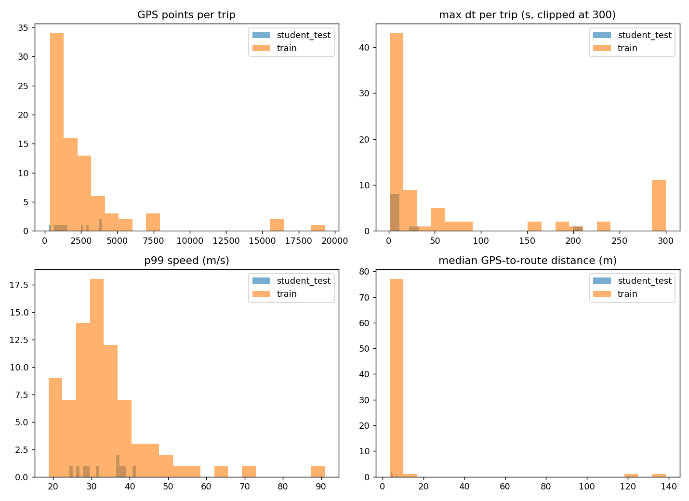
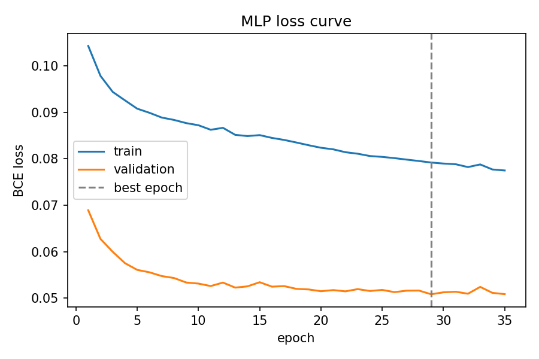
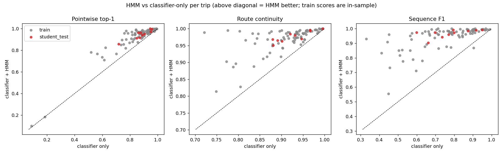

# PathSnap: technical report (generated from results/)

Every number below is read from files in `results/` by `python -m pathsnap.report`. Partitions: **train** = 80 trips, **student_test** = 10 trips. Evaluator trips were never used for any analysis, training, selection or tuning.

## 2. Dataset understanding and EDA

### 2.1 Preprocessing
1. Raw files are whitespace-separated and headerless; loaded by `pathsnap/io.py`.
2. Each trip is projected to its own local metric frame (trips span -34.6 to 61.7 deg latitude, several continents).
3. Candidate arcs: per-trip KD-tree over arcs densified every 10 m, 50 m search radius, nearest-3 fallback, at most 25 candidates per GPS point, duplicate (from, to) arcs collapsed.
4. Labels: the reference `.route` has no timestamps and about 5x fewer arcs than GPS points, so per-point labels come from a monotone dynamic-programming alignment of GPS points to route positions (`labels.py`), cut at GPS gaps over 60 s.
5. 22 label-free features per (point, candidate arc): distance and projection, heading vs arc bearing, speed and sampling interval, network degrees, two-way flag and relative-to-other-candidates ranks (`features.py`).
6. Splits are by trip only (`GroupKFold` on `trip_id`); scalers and imputers live inside pipelines and are fit on training folds only.

### 2.2 Patterns found (partition noted per row)
| Finding | train | student_test |
|---|---:|---:|
| trips | 80 | 10 |
| GPS points | 208,417 | 19,160 |
| road arcs | 3,876,904 | 185,041 |
| route arcs | 31,336 | 3,477 |
| missing / invalid GPS values | 0 / 0 | 0 / 0 |
| trips with non-increasing timestamps | 0 | 0 |
| largest sampling gap (s) | 153,064 | 210 |
| trips with a gap over 60 s | 22 | 1 |
| trips whose route has unconnected consecutive arcs | 10 | 1 |
| mean share of GPS within 30 m of the route | 96.80% | 99.37% |

Notable trips: 054 (GPS far from every road) and 033 (GPS near roads but not near its route) disagree with their reference routes; they are kept in evaluation and reported openly. Details: `results/eda/FINDINGS.md`, `notebooks/01_eda.ipynb`, `results/eda/01_eda.html`.

Folium maps: `results/viz/` (see section 6).

## 3. Model experimentation and comparison

Primary selection metric: observation-level **Top-1** on 5-fold trip-grouped CV over the 80 train trips (it is what the API scores). Ties inside fold noise are broken by log loss, then fit time. Student-test is a development check only. Candidate miss rate is a property of candidate generation: 0.13% of student-test observations have no true arc among the candidates, so Top-1 cannot reach 100%.

### 3.1 Consolidated comparison

| Model | Family | Key configuration | CV Macro F1 | CV Top-1 | Route continuity (student-test, classifier only) | Student-test Macro F1 | Student-test Top-1 | Log loss (CV / test) | Inference (scoring, ms/obs) |
|---|---|---|---:|---:|---:|---:|---:|---|---:|
| Logistic Regression | linear | C=1, L2, lbfgs, standardised | 0.8760 +/- 0.043 | 0.7446 +/- 0.128 | 0.9088 | 0.9111 | 0.8389 | 0.1309 / 0.1009 | 0.0027 |
| Random Forest | bagging | 150 trees, depth 18, min leaf 20, max_samples 0.3 | 0.8821 +/- 0.043 | 0.7549 +/- 0.129 | 0.9207 | 0.9215 | 0.8577 | 0.0942 / 0.0695 | 0.0252 |
| XGBoost (GPU) | boosting | 600 trees max, depth 7, lr 0.05, early stop 40 | 0.8814 +/- 0.041 | 0.7535 +/- 0.126 | 0.9237 | 0.9233 | 0.8610 | 0.0939 / 0.0693 | 0.0057 |
| MLP (PyTorch, GPU) | neural | 128-64, dropout 0.1, AdamW lr 2e-3, AMP | 0.8803 +/- 0.042 | 0.7517 +/- 0.128 | 0.9221 | 0.9201 | 0.8551 | 0.0944 / 0.0713 | 0.0014 |
| LightGBM LambdaRank | ranking | 300 trees, 63 leaves, lr 0.05 (+Platt) | 0.8839 +/- 0.040 | 0.7577 +/- 0.126 | 0.9264 | 0.9234 | 0.8611 | 0.0986 / 0.0817 | 0.0297 |
| LightGBM LambdaRank (Optuna-tuned) | ranking | 374 trees, 49 leaves, lr 0.025 (+Platt) | 0.8850 +/- 0.041 | 0.7597 +/- 0.127 | 0.9278 | 0.9245 | 0.8632 | 0.0946 / 0.0792 | 0.0362 |

Notes: Macro F1 is computed over candidate rows after each observation marks its top-scoring candidate as the prediction. Log loss for the LambdaRank models is on the Platt-calibrated score. Route continuity is the share of consecutive predicted arcs that are equal or head-to-tail connected. Inference time is model scoring only (median of 5 runs over all student-test candidate rows (`results/models/inference_benchmark.csv`); single-shot timings first stored in each model JSON were taken while other jobs ran and are not used. End-to-end API time per trip is 2.8 s on average (section 7). The CV Top-1 std is large because one fold contains trip 054, where 89% of observations have no true candidate; per-fold paired differences (`results/models/paired_folds.csv`) are small by comparison.

Paired CV Top-1 improvement over logistic regression (same folds): Random Forest +0.0104; XGBoost (GPU) +0.0089; MLP (PyTorch, GPU) +0.0071; LightGBM LambdaRank +0.0131; LightGBM LambdaRank (Optuna-tuned) +0.0151. Folds (of 5) where each beats logistic regression: Random Forest 5, XGBoost (GPU) 5, MLP (PyTorch, GPU) 5, LightGBM LambdaRank 5, LightGBM LambdaRank (Optuna-tuned) 5.

### 3.2 Per-model answers

#### Logistic Regression
**A. Understanding.** Interpretable linear baseline. If the engineered features carry the signal, a linear model should already rank candidates sensibly, and it gives probabilities for the HMM. Fast and stable, but cannot model interactions such as 'close but wrong heading'.
**B. Training.** Initial hyperparameters: `{"C": 1.0, "penalty": "l2", "solver": "lbfgs", "max_iter": 500}`. Objective: binary cross-entropy (L2-regularised).
**C. Results.** Student-test: Top-1 0.8389, Macro F1 0.9111, log loss 0.1009, precision 0.8389, recall 0.8399, route continuity 0.9088. CV Top-1 0.7446; train (resubstitution) Top-1 0.7421, so the train-minus-CV gap is -0.0025 (no sign of overfitting).

#### Random Forest
**A. Understanding.** Bagged trees capture non-linear interactions between distance, heading and rank features without much tuning. Robust, but the slowest to train and score here and the largest artifact (72 MB, not committed).
**B. Training.** Initial hyperparameters: `{"n_estimators": 150, "max_depth": 18, "min_samples_leaf": 20, "max_features": "sqrt", "max_samples": 0.3, "n_jobs": 6}`. Objective: Gini impurity splits.
**C. Results.** Student-test: Top-1 0.8577, Macro F1 0.9215, log loss 0.0695, precision 0.8577, recall 0.8587, route continuity 0.9207. CV Top-1 0.7549; train (resubstitution) Top-1 0.7739, so the train-minus-CV gap is +0.0189 (a modest gap: the model fits train better than held-out trips, mild overfitting) while student-test is still higher than CV because student-test is cleaner than the worst train trips.

#### XGBoost (GPU)
**A. Understanding.** Gradient boosting is the strongest general tabular learner, runs on the GPU and trains in seconds on 1.8M candidate rows. Very fast and well calibrated; its train-minus-CV gap is the largest among the classifiers (mild overfitting even with early stopping).
**B. Training.** Initial hyperparameters: `{"n_estimators": 600, "learning_rate": 0.05, "max_depth": 7, "min_child_weight": 5, "subsample": 0.8, "colsample_bytree": 0.8, "reg_lambda": 1.0, "max_bin": 128, "early_stopping_rounds": 40, "val_frac": 0.1}`. Objective: binary:logistic (log loss) with early stopping.
**C. Results.** Student-test: Top-1 0.8610, Macro F1 0.9233, log loss 0.0693, precision 0.8610, recall 0.8621, route continuity 0.9237. CV Top-1 0.7535; train (resubstitution) Top-1 0.7851, so the train-minus-CV gap is +0.0316 (a modest gap: the model fits train better than held-out trips, mild overfitting) while student-test is still higher than CV because student-test is cleaner than the worst train trips.

#### MLP (PyTorch, GPU)
**A. Understanding.** A different family (learned non-linear representation) to test whether a neural network adds anything over trees on 22 engineered features. It is also the only model with an epoch-wise training history. Needs scaling and tuning; slower than boosting and not better here.
**B. Training.** Initial hyperparameters: `{"hidden": [128, 64], "dropout": 0.1, "lr": 0.002, "weight_decay": 0.0001, "batch_size": 8192, "max_epochs": 60, "patience": 6, "val_frac": 0.1, "amp": true, "seed": 42}`. Objective: binary cross-entropy (BCE-with-logits), AdamW, early stopping.
**C. Results.** Student-test: Top-1 0.8551, Macro F1 0.9201, log loss 0.0713, precision 0.8551, recall 0.8562, route continuity 0.9221. CV Top-1 0.7517; train (resubstitution) Top-1 0.7714, so the train-minus-CV gap is +0.0198 (a modest gap: the model fits train better than held-out trips, mild overfitting) while student-test is still higher than CV because student-test is cleaner than the worst train trips.

#### LightGBM LambdaRank
**A. Understanding.** The task is choosing one candidate per observation, so a ranking objective optimises the quantity we are scored on (per-observation Top-1) directly. Best Top-1, but raw scores are not probabilities; we Platt-calibrate them for the HMM, which is slightly worse calibrated than the classifiers.
**B. Training.** Initial hyperparameters: `{"n_estimators": 300, "learning_rate": 0.05, "num_leaves": 63, "min_child_samples": 50, "subsample": 0.5, "subsample_freq": 1, "colsample_bytree": 0.8, "n_jobs": 6}`. Objective: LambdaRank (pairwise NDCG-weighted ranking loss, one group per observation).
**C. Results.** Student-test: Top-1 0.8611, Macro F1 0.9234, log loss 0.0817, precision 0.8611, recall 0.8622, route continuity 0.9264. CV Top-1 0.7577; train (resubstitution) Top-1 0.8210, so the train-minus-CV gap is +0.0633 (a modest gap: the model fits train better than held-out trips, mild overfitting) while student-test is still higher than CV because student-test is cleaner than the worst train trips.

The MLP's best epoch was 29 (early stopping on a held-out tail); its real training/validation loss curve is `results/models/mlp_loss_curve.png`. Other models do not produce epoch-wise histories, so no curves are shown for them.

### 3.3 Visualisations
- `results/models/comparison_plots.png`: CV Macro F1, CV Top-1, student-test Top-1/Macro F1, log loss, route continuity, fit time for all models.
- `results/models/mlp_loss_curve.png`: MLP epoch-wise loss.
- `results/hmm/final/hmm_vs_classifier.png`: classifier-only vs HMM per trip.

## 4. Bayesian hyperparameter optimisation (LightGBM LambdaRank)

Chosen because it had the best CV Top-1 and beat XGBoost on all 5 folds and Random Forest on 4.
1. **Searched:** num_leaves, learning_rate, n_estimators, min_child_samples, subsample, colsample_bytree, reg_lambda.
2. **Ranges:** num_leaves int [15, 127]; learning_rate log [0.02, 0.2]; n_estimators int [100, 500]; min_child_samples int [10, 200]; subsample float [0.4, 1.0]; colsample_bytree float [0.5, 1.0]; reg_lambda log [0.001, 10.0].
3. **Objective:** mean grouped-CV top-1 (5 folds, 80 train trips); sampler TPE (seed 42), median pruner.
4. **Trials:** 20 (20 complete, 0 pruned), 31 minutes. Trial log: `results/tuning/lgbm_rank_trials.csv`.
5. **Best:** `{"num_leaves": 49, "learning_rate": 0.025043908574120786, "n_estimators": 374, "min_child_samples": 94, "subsample": 0.47322294090686734, "colsample_bytree": 0.7475884550556351, "reg_lambda": 0.0013726318898045872}`.
6. **Tuned vs untuned (identical folds and data):**

| | CV Macro F1 | CV Top-1 | Student Top-1 | Student Macro F1 | Log loss (CV / test) | Inference ms/obs |
|---|---:|---:|---:|---:|---|---:|
| untuned | 0.8839 | 0.7577 | 0.8611 | 0.9234 | 0.0986 / 0.0817 | 0.0297 |
| tuned | 0.8850 | 0.7597 | 0.8632 | 0.9245 | 0.0946 / 0.0792 | 0.0362 |

The tuned model is better on 4 of 5 folds, but the gain is small (+0.0020 CV Top-1); we report it as a marginal improvement, not a large one. It is adopted as the final model (`artifacts/final_model.joblib`). Cost: 31 min for the search.

## 5. HMM and Viterbi route reconstruction

1. **Hidden states:** the candidate arcs of each GPS observation (at most 15 kept).
2. **Emission:** log of the final model's probability for the arc, blended with a Gaussian distance term (weights `w_emis`, `w_dist`, sigma 20 m), floored at 1e-6.
3. **Transition:** 0 cost for the same arc or a head-to-tail connection; otherwise a bounded directed shortest-path distance compared with the GPS displacement (exponential penalty, beta), plus an implied-speed term and a U-turn penalty.
4. **Gaps and missing candidates:** the trip is split into segments at GPS gaps over 60 s and Viterbi restarts per segment; every observation has at least 3 candidates.
5. **Disconnected consecutive candidates:** not forbidden; they pay a finite capped penalty (`max_pen`), so a bad link can be crossed when evidence is strong.
6. **Did it help?** Yes on student-test and train (decoder parameters were chosen by random search over train and student-test trips only, scores are out-of-fold on train, 31 configurations tried). Per-trip means:

| | Classifier only | Classifier + HMM |
|---|---:|---:|
| Top-1 (student-test) | 0.8821 | 0.9464 |
| Route continuity (student-test) | 0.9278 | 0.9769 |
| Sequence F1 (student-test) | 0.7796 | 0.9680 |
| Precision (student-test) | 0.6560 | 0.9480 |
| Top-1 (train, out-of-fold) | 0.8488 | 0.9193 |
| Sequence F1 (train, out-of-fold) | 0.7551 | 0.9408 |

Sequence F1 compares the set of predicted arcs (gaps filled by shortest path) with the reference route arcs. The HMM lowers Top-1 on 0 student-test trips and 1 train trip(s) (listed in `results/hmm/final/comparison.csv`). Decoding takes 0.24 s per trip on average (1.4 s at most). Caveat: the decoder parameters were tuned on these same 90 trips, so the gain is slightly optimistic; the evaluator trips are the unbiased check.

## 6. Geographical visualisation (Folium)

- `results/viz/00000001.html`: GPS (blue), road network (grey), reference route (green) with gaps, spikes, off-route points and route breaks as layers.
- `results/viz/hmm_compare*.html`: student-test trip with GPS, reference, classifier-only and HMM routes. `results/viz/world_trips.html`: all trips by location.
- Code: `src/pathsnap/viz.py`, `viz_pred.py`. Maps use Esri tiles because OSM blocks pages opened from disk. Add a screenshot of one map to the PDF.

## 7. API, UI and deployment

Endpoints `GET /health`, `GET /trips`, `POST /predict/{trip_id}`; the UI lists the trips, runs one or all and shows the predicted route and metrics. Reference data never leaves the server. Setup: `docs/DEPLOYMENT.md`, `docs/HANDOFF.md`.

Smoke test (student-test trips through the running API, `results/api_smoke_test.csv`):

| Trip | OK | Latency (s) | Top-1 | Route continuity |
|---|---|---:|---:|---:|
| 00000000 | True | 2.9 | 0.9525 | 0.8718 |
| 00000007 | True | 2.3 | 0.8501 | 0.9918 |
| 00000009 | True | 2.5 | 0.8894 | 0.7937 |
| 00000040 | True | 3.0 | 0.9332 | 0.8899 |
| 00000052 | True | 2.1 | 0.9771 | 0.8608 |
| 00000056 | True | 3.5 | 0.9482 | 0.8627 |
| 00000065 | True | 2.4 | 0.8841 | 0.8409 |
| 00000076 | True | 3.2 | 0.8964 | 0.7473 |
| 00000077 | True | 3.3 | 0.7967 | 0.7180 |
| 00000091 | True | 2.5 | 0.9108 | 0.7960 |

**To add by the team:** screenshots of the working UI and of the API console on the receiving laptop (required by the guidelines), and the final run on the evaluator trips.

### 7.1 Final run on the evaluator trips (single run, nothing tuned afterwards)

Model and decoder were frozen before this run; it was executed once through the API and reported as is (`results/evaluator_run.csv`). The API's route continuity is computed on the decoded arcs per observation without gap filling, so it is lower than the gap-filled continuity quoted in section 5.

| Trip | OK | Latency (s) | Top-1 | Route continuity | GPS points |
|---|---|---:|---:|---:|---:|
| 00000015 | True | 0.97 | 0.8710 | 0.6497 | 6854 |
| 00000017 | True | 0.90 | 0.9532 | 0.7259 | 1346 |
| 00000023 | True | 0.20 | 0.9454 | 0.8305 | 458 |
| 00000030 | True | 0.35 | 0.8853 | 0.7241 | 654 |
| 00000049 | True | 0.79 | 0.9962 | 0.9618 | 2642 |
| 00000059 | True | 0.49 | 0.9767 | 0.7910 | 1031 |
| 00000067 | True | 0.17 | 0.9672 | 0.8784 | 916 |
| 00000073 | True | 0.36 | 0.9808 | 0.9359 | 1144 |
| 00000087 | True | 0.90 | 0.9943 | 0.9658 | 1399 |
| 00000094 | True | 0.83 | 0.9492 | 0.8152 | 3230 |
| **Mean** | 10/10 | 0.60 | 0.9519 | 0.8278 | |

## 8. Limitations

- The reference route is reference information, not verified truth; 11 trips have route breaks and trips 033/054 disagree with their routes.
- Student-test is cleaner than train (no long gaps or implausible speeds), so its scores are optimistic relative to the hardest train trips.
- Decoder parameters and the model choice used train and student-test only; the evaluator trips were only run once, at the end.