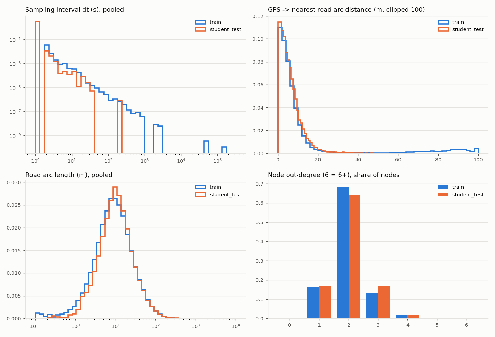
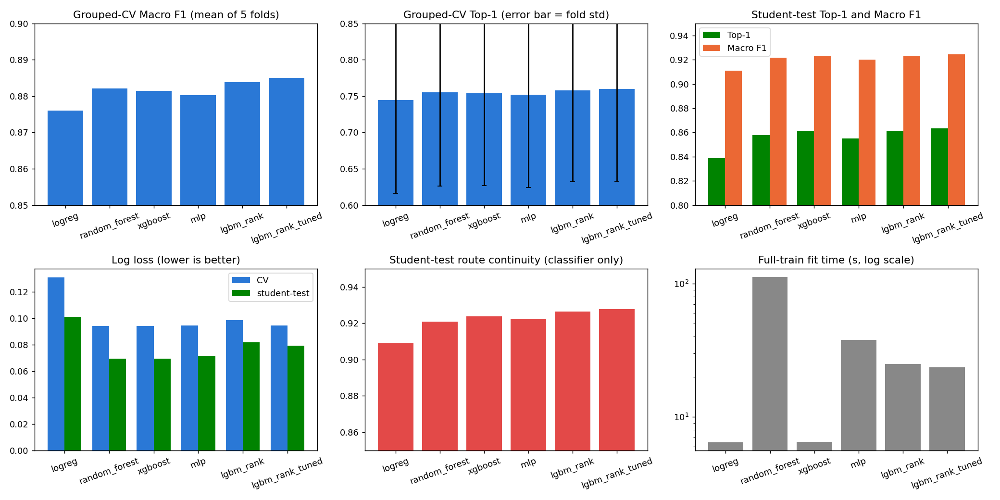
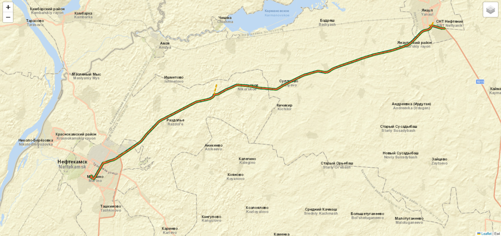
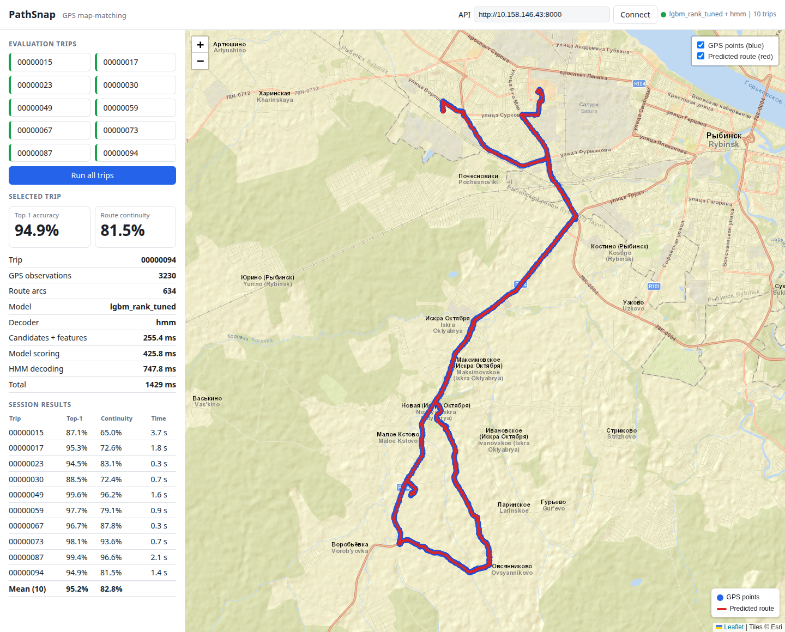
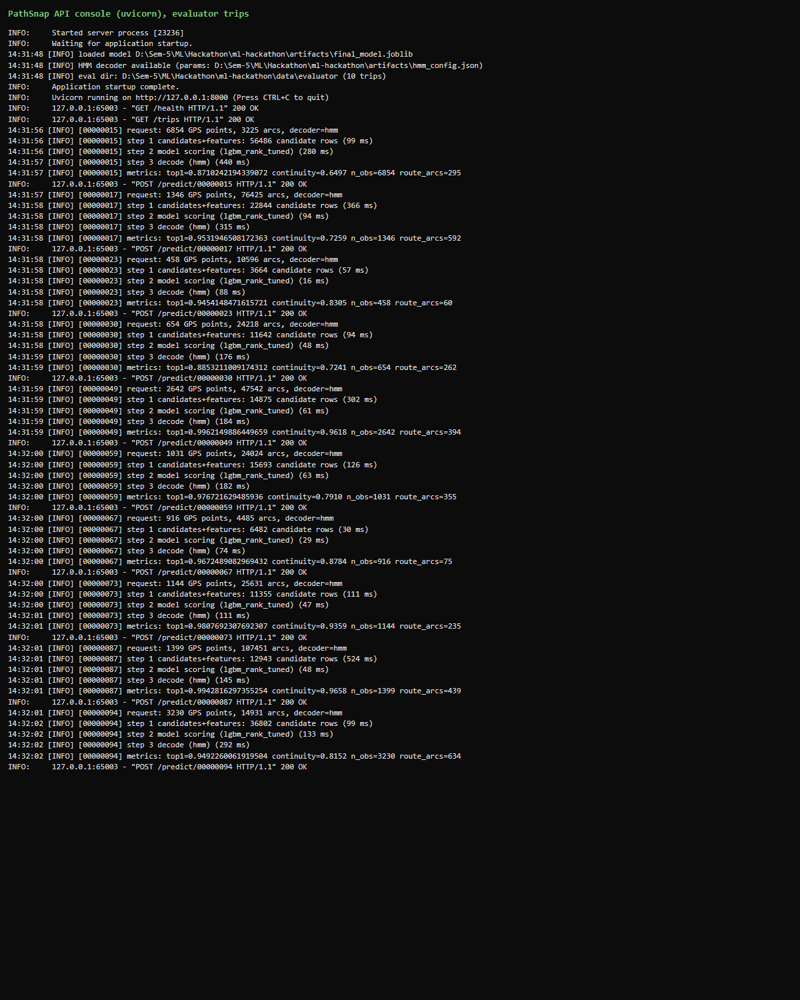

# PathSnap: GPS Map-Matching and Route Reconstruction

**Project report**

**GitHub repository:** [https://github.com/hmAdil/ml-hackathon](https://github.com/hmAdil/ml-hackathon) (public, branch `main`)

## 1. Problem and approach

Each trip provides a noisy GPS track (`longitude latitude timestamp`), a trip-specific road network (nodes and directed arcs) and, for training, a reference route (the ordered arcs driven). The task is to reconstruct the route from the track and network alone. Arc identifiers are local to each trip, so the problem cannot be posed as multi-class classification over arc ids. The pipeline has three stages:

1. **Candidate generation:** for every GPS point, the nearby road arcs (50 m radius, at least 3 and at most 25 per point).
2. **Candidate scoring:** a model estimates, for each (point, arc) pair, how likely the arc is the one driven.
3. **HMM / Viterbi decoding:** a sequence model picks the most plausible connected route using the model scores and road-network constraints.

Models are trained and compared on the 80 training trips with 5-fold cross-validation split by trip; the 10 student-test trips are a development check; the 10 evaluator trips are run once through the API at the end.

## 2. Dataset and exploratory analysis

| | train | student_test |
|---|---:|---:|
| trips | 80 | 10 |
| GPS points | 208,417 | 19,160 |
| road arcs | 3,876,904 | 185,041 |
| reference-route arcs | 31,336 | 3,477 |
| missing / invalid GPS values | 0 / 0 | 0 / 0 |
| trips with non-increasing timestamps | 0 | 0 |
| largest sampling gap (s) | 153,064 | 210 |
| trips with a gap over 60 s | 22 | 1 |
| trips whose route has unconnected consecutive arcs | 10 | 1 |
| mean share of GPS points within 30 m of the route | 96.80% | 99.37% |

Findings that shaped the design:

- Trips come from different continents, so each is projected to its own local metric frame; haversine is used for true distances.
- The reference route is an arc list without timestamps and has about five times fewer entries than GPS points, so per-point labels are built by a monotone dynamic-programming alignment of points to the route (section 3).
- A few trips have long sampling gaps (up to 153,064 s) and some routes contain breaks; the decoder therefore splits trips into segments at gaps over 60 s and allows finite-cost jumps between disconnected arcs.
- Trips 054 and 033 disagree strongly with their reference routes, which lowers cross-validation scores on the folds that contain them.

## 3. Preprocessing and feature engineering

**Label construction.** Reference arcs are aligned to GPS points with a monotone Viterbi alignment (route position never moves backwards, emission cost from point-to-arc distance, segments cut at gaps over 60 s). A candidate row is positive when its arc equals the aligned arc.

**Candidates.** A KD-tree over arcs densified every 10 m returns arcs within 50 m of each point; duplicate (from, to) arcs are collapsed. Splits are always by trip; imputers and scalers are fitted on training folds only.

**22 features per (GPS point, candidate arc)**, computed from the track and network only:

| Group | Features | Meaning |
|---|---|---|
| Spatial | `dist_m`, `log_dist`, `frac`, `along_m`, `to_end_m` | distance to the arc, and where the projection falls along it |
| Direction | `ang_diff`, `cos_diff`, `heading_valid` | difference between travel heading (central difference of neighbouring points) and the arc bearing; neutral value when the vehicle is not moving |
| Movement | `speed_ms`, `dt_prev`, `dt_next` | implied speed and the sampling interval before and after the point |
| Network | `arc_len_m`, `log_arc_len`, `is_two_way`, `out_deg_to`, `in_deg_from` | arc length, whether the reverse arc exists, and junction degrees at its ends |
| Relative to the other candidates | `dist_minus_min`, `dist_over_min`, `dist_rank`, `ang_rank`, `ang_minus_min`, `n_cands` | how an arc compares with the closest candidate for the same GPS point |

The relative features carry most of the signal, because the same distance can be good in a sparse area and poor in a dense one.

## 4. Model experimentation and comparison

Selection metric: observation-level **Top-1** on 5-fold trip-grouped cross-validation over the 80 training trips (ties broken by log loss, then fit time). Macro F1 is computed over candidate rows, with each observation's top-scoring candidate as the single predicted positive. Route continuity is the share of consecutive predicted arcs that are equal or head-to-tail connected. 0.13% of student-test observations have no true arc among the candidates, which caps Top-1.

| Model | Family | CV Macro F1 | CV Top-1 | Route continuity (test) | Test Macro F1 | Test Top-1 | Log loss (CV / test) | Inference (ms / obs) |
|---|---|---:|---:|---:|---:|---:|---|---:|
| Logistic Regression | linear | 0.8760 | 0.7446 | 0.9088 | 0.9111 | 0.8389 | 0.1309 / 0.1009 | 0.0027 |
| Random Forest | bagging | 0.8821 | 0.7549 | 0.9207 | 0.9215 | 0.8577 | 0.0942 / 0.0695 | 0.0252 |
| XGBoost (GPU) | boosting | 0.8814 | 0.7535 | 0.9237 | 0.9233 | 0.8610 | 0.0939 / 0.0693 | 0.0057 |
| MLP (PyTorch, GPU) | neural | 0.8803 | 0.7517 | 0.9221 | 0.9201 | 0.8551 | 0.0944 / 0.0713 | 0.0014 |
| LightGBM LambdaRank | ranking | 0.8839 | 0.7577 | 0.9264 | 0.9234 | 0.8611 | 0.0986 / 0.0817 | 0.0297 |
| LightGBM LambdaRank (Optuna-tuned) | ranking | 0.8850 | 0.7597 | 0.9278 | 0.9245 | 0.8632 | 0.0946 / 0.0792 | 0.0362 |

Every other model beats logistic regression on CV Top-1 in every fold: Random Forest 5/5; XGBoost (GPU) 5/5; MLP (PyTorch, GPU) 5/5; LightGBM LambdaRank 5/5; LightGBM LambdaRank (Optuna-tuned) 5/5.

### Logistic Regression
**Why this model.** A linear baseline that tests how much of the signal the engineered features carry on their own; it outputs probabilities the HMM can use directly.

**Training.** Parameters `{"C": 1.0, "penalty": "l2", "solver": "lbfgs", "max_iter": 500}`; objective: binary cross-entropy with L2 regularisation.

**Results.** Test Top-1 0.8389, Macro F1 0.9111, precision 0.8389, recall 0.8399, log loss 0.1009, route continuity 0.9088. CV Top-1 0.7446; training-set Top-1 0.7421.

### Random Forest
**Why this model.** Bagged trees capture interactions between distance, heading and rank features with little tuning.

**Training.** Parameters `{"n_estimators": 150, "max_depth": 18, "min_samples_leaf": 20, "max_features": "sqrt", "max_samples": 0.3, "n_jobs": 6}`; objective: Gini impurity splits over bootstrap samples.

**Results.** Test Top-1 0.8577, Macro F1 0.9215, precision 0.8577, recall 0.8587, log loss 0.0695, route continuity 0.9207. CV Top-1 0.7549; training-set Top-1 0.7739.

### XGBoost (GPU)
**Why this model.** Gradient boosting is a strong tabular learner and trains on the GPU in seconds on 1.8M candidate rows.

**Training.** Parameters `{"n_estimators": 600, "learning_rate": 0.05, "max_depth": 7, "min_child_weight": 5, "subsample": 0.8, "colsample_bytree": 0.8, "reg_lambda": 1.0, "max_bin": 128, "early_stopping_rounds": 40, "val_frac": 0.1}`; objective: binary logistic loss with early stopping.

**Results.** Test Top-1 0.8610, Macro F1 0.9233, precision 0.8610, recall 0.8621, log loss 0.0693, route continuity 0.9237. CV Top-1 0.7535; training-set Top-1 0.7851.

### MLP (PyTorch, GPU)
**Why this model.** A neural model from a different family, with an epoch-wise training history.

**Training.** Parameters `{"hidden": [128, 64], "dropout": 0.1, "lr": 0.002, "weight_decay": 0.0001, "batch_size": 8192, "max_epochs": 60, "patience": 6, "val_frac": 0.1, "amp": true, "seed": 42}`; objective: binary cross-entropy (BCE-with-logits), AdamW, early stopping.

**Results.** Test Top-1 0.8551, Macro F1 0.9201, precision 0.8551, recall 0.8562, log loss 0.0713, route continuity 0.9221. CV Top-1 0.7517; training-set Top-1 0.7714.

### LightGBM LambdaRank
**Why this model.** The task is to pick one candidate per observation, so a ranking objective optimises the quantity we are scored on (per-observation Top-1). Scores are Platt-calibrated for the HMM.

**Training.** Parameters `{"n_estimators": 300, "learning_rate": 0.05, "num_leaves": 63, "min_child_samples": 50, "subsample": 0.5, "subsample_freq": 1, "colsample_bytree": 0.8, "n_jobs": 6}`; objective: LambdaRank, one query group per GPS observation.

**Results.** Test Top-1 0.8611, Macro F1 0.9234, precision 0.8611, recall 0.8622, log loss 0.0817, route continuity 0.9264. CV Top-1 0.7577; training-set Top-1 0.8210.

The MLP's best epoch was 37; its training and validation loss curve:

## 5. Bayesian hyperparameter optimisation

Optuna with the TPE sampler (seed 42) and a median pruner. The objective is the mean 5-fold trip-grouped CV Top-1 on the training trips; trial 0 is the default configuration. Student-test and evaluator trips are never used.

| Model | Trials (pruned) | Search space | Best CV Top-1 | Best parameters |
|---|---:|---|---:|---|
| Logistic Regression | 15 (0) | C 0.001-100.0, class_weight ['none', 'balanced'] | 0.7446 | `{"C": 84.70268, "class_weight": null}` |
| XGBoost (GPU) | 20 (0) | max_depth 3-10, learning_rate 0.02-0.3, min_child_weight 1.0-20.0, subsample 0.5-1.0, colsample_bytree 0.4-1.0, reg_lambda 0.01-50.0, reg_alpha 0.001-10.0, gamma 0.0-2.0, n_estimators 200-1000 | 0.7535 | `{"n_estimators": 938, "learning_rate": 0.0879, "max_depth": 7, "min_child_weight": 4.51223, "subsample": 0.98479, "colsample_bytree": 0.86508, "reg_lambda": 29.86609, "reg_alpha": 3.79585, "gamma": 1.1958}` |
| LightGBM LambdaRank | 20 (0) | num_leaves 15-127, learning_rate 0.02-0.2, n_estimators 100-500, min_child_samples 10-200, subsample 0.4-1.0, colsample_bytree 0.5-1.0, reg_lambda 0.001-10.0 | 0.7597 | `{"n_estimators": 374, "learning_rate": 0.02504, "num_leaves": 49, "min_child_samples": 94, "subsample": 0.47322, "colsample_bytree": 0.74759, "reg_lambda": 0.00137}` |

**LightGBM LambdaRank** (selected for tuning because it had the best CV Top-1): 20 trials in 31 minutes.

| | CV Macro F1 | CV Top-1 | Test Top-1 | Test Macro F1 | Log loss (CV / test) |
|---|---:|---:|---:|---:|---|
| default | 0.8839 | 0.7577 | 0.8611 | 0.9234 | 0.0986 / 0.0817 |
| tuned | 0.8850 | 0.7597 | 0.8632 | 0.9245 | 0.0946 / 0.0792 |

The tuned configuration is better on 4 of 5 folds (+0.0020 mean CV Top-1) and is the final model.

## 6. HMM and Viterbi route reconstruction

- **Hidden states:** the candidate arcs of each GPS observation (at most 15 kept).
- **Emission:** log of the final model's probability for the arc, blended with a Gaussian distance term, floored at 1e-6.
- **Transition:** zero cost for the same arc or a head-to-tail connection; otherwise a bounded directed shortest-path distance is compared with the GPS displacement (exponential penalty), with an implied-speed term and a U-turn penalty.
- **Gaps and breaks:** trips are split into segments at gaps over 60 s and Viterbi restarts per segment; disconnected consecutive candidates pay a finite capped penalty instead of being forbidden.
- **Parameters:** chosen by random search (31 configurations) on train and student-test trips, with out-of-fold model scores on train.

| Mean per trip | Classifier only | Classifier + HMM |
|---|---:|---:|
| Top-1 (student-test) | 0.8821 | 0.9464 |
| Route continuity (student-test) | 0.9278 | 0.9769 |
| Sequence F1 (student-test) | 0.7796 | 0.9680 |
| Precision (student-test) | 0.6560 | 0.9480 |
| Top-1 (train, out-of-fold) | 0.8488 | 0.9193 |
| Sequence F1 (train, out-of-fold) | 0.7551 | 0.9408 |

Sequence F1 compares the predicted arc set (gaps filled by shortest path) with the reference route. Decoding takes 0.24 s per trip on average.

## 7. Geographical visualisation (Folium)

Interactive maps in `results/viz/`: per-trip maps with GPS points, road network, reference route and data-quality layers; a comparison map with the reference, classifier-only and HMM routes; and a world map of all trips. The basemap is Esri.

## 8. API, UI and deployment

The FastAPI service (`GET /health`, `GET /trips`, `POST /predict/{trip_id}`) runs candidate generation, the final model and the HMM on each request, and computes Top-1 and route continuity against the reference on the server; the reference route is never returned to the client. The UI (static HTML and JavaScript) lists the trips, runs one or all, draws the GPS points and predicted route on a map and shows the metrics. The API runs on Laptop 1 and the UI on Laptop 2, connected over the same network. Setup steps: `docs/DEPLOYMENT.md`.

### Evaluator trips (single run through the API)

| Trip | Latency (s) | Top-1 | Route continuity | GPS points |
|---|---:|---:|---:|---:|
| 00000015 | 0.97 | 0.8710 | 0.6497 | 6854 |
| 00000017 | 0.90 | 0.9532 | 0.7259 | 1346 |
| 00000023 | 0.20 | 0.9454 | 0.8305 | 458 |
| 00000030 | 0.35 | 0.8853 | 0.7241 | 654 |
| 00000049 | 0.79 | 0.9962 | 0.9618 | 2642 |
| 00000059 | 0.49 | 0.9767 | 0.7910 | 1031 |
| 00000067 | 0.17 | 0.9672 | 0.8784 | 916 |
| 00000073 | 0.36 | 0.9808 | 0.9359 | 1144 |
| 00000087 | 0.90 | 0.9943 | 0.9658 | 1399 |
| 00000094 | 0.83 | 0.9492 | 0.8152 | 3230 |
| **Mean** | 0.60 | 0.9519 | 0.8278 | |

**UI on Laptop 2 after running all ten trips:**

**API console on Laptop 1 while serving the requests:**

### Student-test run through the API

| Trip | Latency (s) | Top-1 | Route continuity |
|---|---:|---:|---:|
| 00000000 | 2.9 | 0.9525 | 0.8718 |
| 00000007 | 2.3 | 0.8501 | 0.9918 |
| 00000009 | 2.5 | 0.8894 | 0.7937 |
| 00000040 | 3.0 | 0.9332 | 0.8899 |
| 00000052 | 2.1 | 0.9771 | 0.8608 |
| 00000056 | 3.5 | 0.9482 | 0.8627 |
| 00000065 | 2.4 | 0.8841 | 0.8409 |
| 00000076 | 3.2 | 0.8964 | 0.7473 |
| 00000077 | 3.3 | 0.7967 | 0.7180 |
| 00000091 | 2.5 | 0.9108 | 0.7960 |

## 9. Repository

Code, results and documentation: [https://github.com/hmAdil/ml-hackathon](https://github.com/hmAdil/ml-hackathon). Layout: `src/pathsnap/` (pipeline), `tests/`, `ui/`, `scripts/`, `artifacts/` (final model and decoder configuration), `results/` (metrics, tuning logs, figures, maps), `docs/`.
